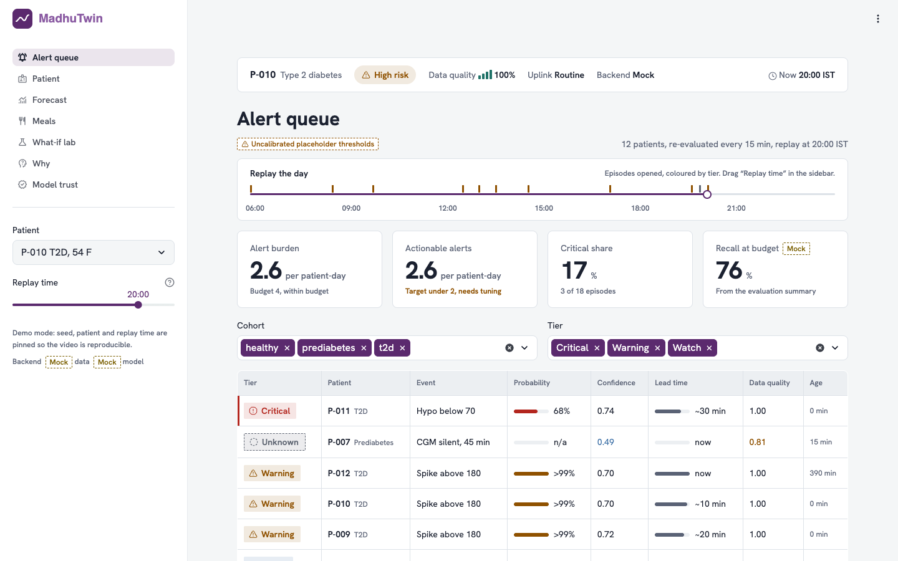
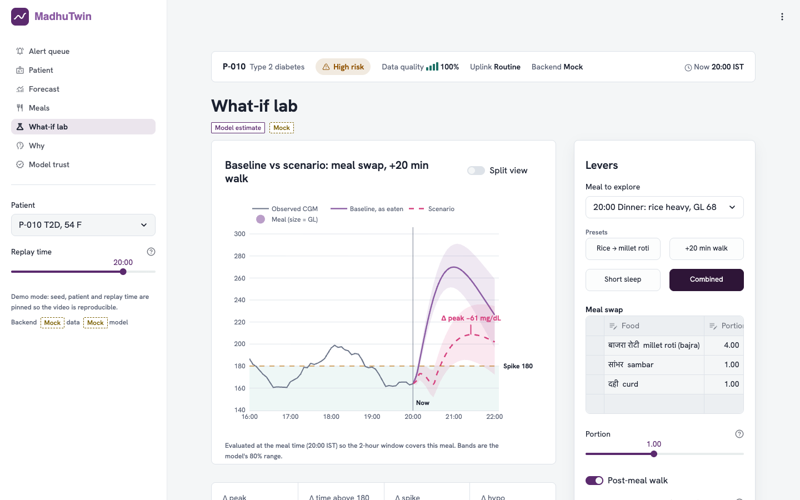
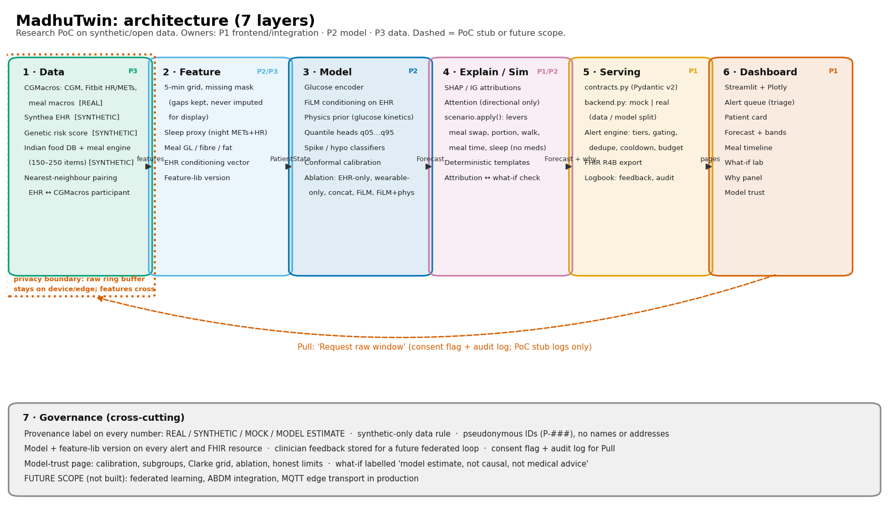

# MadhuTwin: a Type 2 Diabetes digital twin (research PoC)

> **An open, ablation-tested, EHR-conditioned T2D digital twin with a clinician-facing what-if lab.**
> Built for the Happiest Health *Reimagining and Reforming Healthcare in India* Summit 2026, Digital Twin PoC track (Bengaluru, 20 Nov 2026).
>
> **Synthetic/open data only. Research PoC, not a medical device. Not medical advice.**

| | |
|---|---|
| **Team** | `TeamName` *(fill in)*: Person 1 frontend/integration, Person 2 model, Person 3 data |
| **College** | `CollegeName` *(fill in)* |
| **Project title** | MadhuTwin: an EHR-conditioned digital twin for 2-hour glycaemic event forecasting |
| **Video** | `<link to ≥ 20-min video>` *(fill in)* |
| **Licence** | [Apache-2.0](LICENSE) (includes a patent grant, which suits health code) |
| **Repository name** | Must be **`TeamName_CollegeName`** at submission (brief). It is developed as `MadhuTwin_TeamName/`. All paths are relative, so renaming is safe ([ADR-001](docs/decisions.md)). |



---

## Problem statement and use case

People with T2D in India face frequent post-meal glucose spikes, often driven by high-glycaemic-load staples such as polished white rice, short sleep and little activity after meals. Hypoglycaemia is the rarer and more dangerous event, especially on sulfonylureas. Clinicians see HbA1c every few months. They rarely see *what happens after dinner*.

MadhuTwin fuses a **static stream** (Synthea-simulated EHR: age, sex, BMI, HbA1c, fasting glucose, lipids, comorbidities, a clearly synthetic genetic risk score) with a **dynamic stream** (CGMacros CGM, Fitbit heart rate and METs, meal macros, and a sleep *proxy*). It forecasts glucose up to **2 hours** ahead with uncertainty bands, and flags a **spike > 180 mg/dL** or a **hypo < 70 mg/dL**.

A clinician uses it to:
1. **Triage** a panel: an alert queue ranked by tier, lead time and probability, under a measured alert budget.
2. **Understand** one patient: forecast bands, meals, data quality, and plain-language reasons.
3. **Explore** options: a what-if lab (meal swap, portion, post-meal walk, meal timing, sleep), shown side by side with deltas and uncertainty.
4. **Hand off**: a FHIR R4B export of readings, forecast and risk.

## What we claim, and what we do not

| Claim | How it shows up | What we do **not** claim |
|---|---|---|
| **Open and reproducible** | Open code, documented EHR↔CGM pairing, fixed seeds, diagrams as code, a deterministic demo mode | Not "first" or "only". No clinical validation |
| **Clinician-first what-if lab** | 5 levers, presets, baseline vs scenario, Δ peak / Δ time > 180 / Δ probabilities, band-overlap warning, plain-language counterfactual | Effects are **model estimates from observational data, not causal**. Medication is never a lever |
| **Measured fusion** | Ablation of EHR-only, wearable-only, concat, FiLM, FiLM + physics, with CIs; the best row is highlighted only if CIs don't overlap | Fusion may not beat glucose-only. The table says so if it doesn't |
| **Trust engineering** | Conformal intervals, confidence-gated tiers, alert burden vs budget, attribution ↔ what-if agreement check, a model-trust page | Thresholds are not clinically validated |

**Positioning against commercial products.**
- *Fitterfly* has 37k+ Indian foods, a 3-hour horizon and patents. We do not compete on food coverage or horizon.
- *January AI* is a consumer 2-hour food-response app.
- *Twin Health* is a closed care-team product with an RCT.

Our 150–250-item Indian meal mapping is *table stakes, done openly*, not the selling point.

## Features (Person 1 scope)

| ID | Feature | Where |
|---|---|---|
| F10 | Doctor dashboard: alert queue, patient card, forecast, meals, what-if, why, model trust | `dashboard/` |
| F4 | What-if lab: meal swap (searchable food DB, portion units), portion slider, post-meal walk, meal-time shift, prior-night sleep; presets; saved scenarios as small multiples | `dashboard/pages/whatif_lab.py`, `src/serving/scenario.py` |
| F7 | Alert queue: CRITICAL / WARNING / WATCH, confidence gating that never suppresses hypo, episode dedupe with hysteresis, cooldown, escalation, burden metric, feedback buttons, replay | `src/serving/alerts.py`, `dashboard/pages/alert_queue.py` |
| F6 | Why panel: signed attributions grouped by Meal / Activity / Sleep (proxy) / EHR / Recent glucose, attention heatmap (*directional, not rigorous*), deterministic templates, agreement check | `src/explain/templates.py`, `dashboard/pages/explain_panel.py` |
| F9 | FHIR R4B export (Patient, CGM Observations with LOINC 99504-3, RiskAssessment, forecast Observation) and a privacy-boundary diagram | `src/serving/fhir_export.py`, `docs/samples/fhir_bundle_example.json`, `docs/privacy_boundary.pdf` |
| | Every number carries a provenance label: `REAL` / `SYNTHETIC` / `MOCK` / `MODEL ESTIMATE` | `dashboard/components/common.py` |



## Quickstart

```bash
python3 -m venv .venv && source .venv/bin/activate
pip install -r requirements.txt
MADHUTWIN_BACKEND=mock streamlit run dashboard/app.py
```

Reproducible demo (pinned patient P-010, replay time 20:00 IST, fixed seed):

```bash
MADHUTWIN_DEMO=1 MADHUTWIN_BACKEND=mock streamlit run dashboard/app.py
```

Switching to teammates' outputs needs a config flag only, with no page changes:

| Env var | Values | Meaning |
|---|---|---|
| `MADHUTWIN_BACKEND` | `mock` (default) / `real` | default for both subsystems |
| `MADHUTWIN_DATA` | `mock` / `real` | P3 data: profiles, time series, meals, food DB, meal engine |
| `MADHUTWIN_MODEL` | `mock` / `real` | P2 model: `predict_api.py` and `reports/` |

The sidebar footer always shows which backend is active, with one provenance badge per forecast part.

### Running on the teammates' outputs

```bash
python scripts/export_contract_data.py                   # P3 pipeline -> data/processed/{patient_profiles,timeseries,meals}/
MADHUTWIN_BACKEND=real streamlit run dashboard/app.py     # P3 data + P2 model
MADHUTWIN_MODEL=real streamlit run dashboard/app.py       # mock cohort + P2 model
```

What "real" means today ([ADR-015, ADR-016](docs/decisions.md)):

| Subsystem | Delivered | How it is wired |
|---|---|---|
| **P2 model** | XGBoost spike classifier (`models/xgb_all_cgmacros.json`, 514 features, 6 h history, target max > 180 mg/dL) | `predict_api.py` puts its probability into `spike_prob`. The curve, bands, hypo risk and confidence still come from the mock, so the forecast is labelled **MOCK** and the sidebar shows *MODEL_ESTIMATE spike probability · MOCK curve, bands, hypo*. No attributions and no `reports/` yet. |
| **P3 data** | Data pipeline, meal engine and a 171-item Indian food table | `scripts/export_contract_data.py` runs P3's own steps and writes the per-patient contract files. `src/serving/p3_bridge.py` maps P3's food table and engine onto `food_db()` / `resolve_meal()`. Without `data/raw/cgmacros/` it uses P3's seeded demo cohort, so everything is **SYNTHETIC**. |

The classifier sees only the past six hours, so a planned walk, a later meal or the sleep proxy cannot change its probability. The what-if lab shows **n/a** for Δ spike probability for those levers rather than a misleading 0. When a patient has under six hours of fresh history, that forecast falls back to the mock and says so; it does not break the alert queue.

## Design: "Jamun"

The interface is a calm clinical instrument with one bold element, the **Twin Curve**: glucose history flowing into a translucent jamun forecast cone over the 70–180 mg/dL target band. The colour comes from jamun, a fruit traditionally linked with blood-sugar care in Indian households.

- **Figma:** [MadhuTwin — Jamun UI](https://www.figma.com/design/lGkCcYYcV1PHiNWpD1pOjG). Variables, components and screens.
- **Code:**
  - `dashboard/theme/` holds the tokens, the generated CSS and the Plotly templates.
  - `dashboard/components/kit.py` holds the components.
  - `dashboard/components/twin_morph.py` holds the What-if morph.
- **Accessibility:** light and dark themes, both WCAG AA (`python scripts/check_contrast.py`). Visible focus and reduced-motion support.
- **Screenshots:** every page at 1440×900 and 1280×720 in both themes is in `docs/figures/ui/` (`python scripts/ui_screenshots.py`).
- **Further reading:** [`docs/design_notes.md`](docs/design_notes.md) (what we tried and rejected) and [`docs/design_system_rules.md`](docs/design_system_rules.md).

## Architecture



PDF: [`docs/architecture_diagram.pdf`](docs/architecture_diagram.pdf). Source (diagram as code): [`docs/architecture/build_diagrams.py`](docs/architecture/build_diagrams.py).

- **Contracts first.** [`src/contracts.py`](src/contracts.py) holds Pydantic v2 models for every cross-team interface. Pages read only through [`src/serving/backend.py`](src/serving/backend.py), which validates real payloads. A malformed payload becomes a visible error card, never a silent failure. Requests to P2/P3: [`docs/contract_requests.md`](docs/contract_requests.md).
- **What-if is applied by P1, not inside the model** ([ADR-005](docs/decisions.md)). `scenario.apply` rewrites the model input (meals, activity, sleep proxy), so mock and real models get identical what-if behaviour.
- **Recall-first alerts under a budget.**
  - Missing or stale data is shown as **UNKNOWN**, never "low risk".
  - Low confidence only demotes an alert to WATCH. A hypo alert is never suppressed.
  - Every alert records its detectors, horizon, probability, lead time, data quality and model version.
- **Privacy boundary** ([`docs/privacy_boundary.pdf`](docs/privacy_boundary.pdf)):
  - The raw ring buffer stays on the device; only features cross.
  - IDs are pseudonymous, and the project uses synthetic/open data only.
  - "Request raw window" is a consent-flagged, audited **stub**.
  - Federated learning and ABDM are **future scope**.
  - This *fits the spirit of data-minimisation (e.g. DPDP Act); it is not a compliance claim.*

### Tech stack and model details
- **Dashboard:** Streamlit 1.56 + Plotly 6, with the Okabe-Ito colour-blind-safe palette. Severity is always shown as icon + text, never colour alone.
- **Serving:** Python 3.11+, Pydantic v2, pandas, NumPy/SciPy; FHIR via `fhir.resources` 8.1 (R4B models).
- **Model (P2), delivered:** an XGBoost binary spike classifier trained on CGMacros (72 × 7 five-minute channels plus 10 static features; prevalence 7%). The probability cut-off of 0.5 is a technical default, not validated. See [`PERSON1_HANDOFF.md`](PERSON1_HANDOFF.md).
- **Model (P2), planned and not yet delivered:** a glucose encoder with FiLM conditioning on the EHR vector, an optional physics prior, quantile heads (q05–q95), and conformal calibration, evaluated with bootstrap CIs, PR-AUC, F2, lead time, false alarms per patient-day, Clarke grid and subgroups. Until it lands, the trust page reports are missing on the real backend.
- **Mock predictor (P1):** a transparent physiological model. It also supplies the curve, bands and hypo risk around P2's classifier.
  - Gamma-kernel meal response scaled by glycaemic load, with an insulin-resistance gain from HbA1c and BMI.
  - A post-meal walk effect and a sleep-debt penalty.
  - Anchoring to recent CGM with a damped trend.
  - Attributions by finite-difference perturbation through the same pipeline, so they are faithful by construction and give a ground truth for testing templates.
  - Labelled **MOCK** everywhere. It is not a clinical model.
- **Why templates, not an LLM:** explanations are deterministic templates. Generated free text can hallucinate clinical claims (risk P20 in the research report). Templates can't, and they are snapshot-tested.

## Data and licence register

| Dataset | Use | Provenance | Licence |
|---|---|---|---|
| CGMacros | CGM, Fitbit HR/METs, meal macros | REAL | **Verify.** One paper reports CC BY-NC-SA 4.0. The *NonCommercial* clause needs checking against the prize terms |
| Synthea | Simulated EHR | SYNTHETIC | Apache-2.0 |
| IFCT / INDB-derived food table | Indian meal augmentation | SYNTHETIC | **Verify** the IFCT/INDB terms |
| Genetic risk score | Static feature | SYNTHETIC | Generated in-project; no genotype data |
| Mock cohort (`src/serving/mock_data.py`) | Development and demo until integration | MOCK | Apache-2.0 (this repo) |
| P3 demo cohort (`scripts/build_dataset.py`, seed 42) | `MADHUTWIN_DATA=real` until the CGMacros files are placed in `data/raw/cgmacros/` | SYNTHETIC | Apache-2.0 (this repo) |

The CGM LOINC code **99504-3** (interstitial-fluid glucose, mass/volume) was checked against the HL7 CGM implementation guide's sensor-reading profile.

## Reproducibility
- Mock cohort seed `20261120` (per-patient offsets). Mock predictions are deterministic, and a test asserts this.
- Diagrams and the FHIR sample are regenerated from code:
  - `python docs/architecture/build_diagrams.py`
  - `python -m src.serving.fhir_export`
- `docs/samples/fhir_bundle_example.json` is checked by a test to equal a fresh export.
- Slide figures: `MADHUTWIN_BACKEND=mock python dashboard/export_figures.py` writes `docs/figures/*.png`.

## Tests and quality gates

```bash
pip install -r requirements.txt   # includes xgboost for P2's model (also pinned in requirements-model.txt)
pytest -q                 # unit, property (Hypothesis), theme/contrast, P2/P3 integration and AppTest smoke tests
pytest -q -m contract     # integration gate: the same contract assertions against MADHUTWIN_BACKEND=real
ruff check src/serving src/explain dashboard tests && black --check src/serving src/explain dashboard tests
```

The contract gate checks `data/processed/` when it exists, or exports P3's pipeline to a temp directory first.

| Measured (MacBook, mock backend) | Target | Result |
|---|---|---|
| What-if recompute (Combined preset, incl. attributions) | < 300 ms | **3 ms** median, 4 ms max |
| First page load, cold (Python imports + data + full-day alert replay + render) | < 3 s | **3.1 s** (replay ≈ 1.9 s, cached afterwards) |
| Warm rerun | | 0.02 s |

The cold first load is just over target. The replay result is cached for the session, so every later interaction is warm.

## Limitations (from the architecture doc's "Honest limits")
- The EHR↔CGM **pairing is synthetic** (nearest neighbour on status, age, BMI and HbA1c bands). It is disclosed on every patient card.
- **45 participants** means wide confidence intervals.
- The **sleep signal is a proxy** derived from night METs and heart rate.
- **Thresholds are not clinically validated.** Placeholders are badged UNCALIBRATED until P2's validation-chosen `thresholds.json` lands.
- **Fusion may not beat glucose-only.** The ablation shows whether it does.
- Mock-only: the mock predictor and the MOCK reports are placeholders, not results.
- **The real forecast is a hybrid.** Only the spike probability comes from P2's classifier. Its curve can show a peak above 180 next to a low spike probability, because the two come from different models. Both carry their own badge.
- **The real-data cohort is P3's demo cohort** (10 participants, 3 days each, SYNTHETIC) until the CGMacros files are added. 3 days is under the cold-start bar, so every patient card shows "limited history".

## Future scope
- Federated learning on-device. The clinician feedback log (`logs/feedback.jsonl`) is its seed.
- ABDM integration for consent-managed exchange.
- MQTT edge transport in production.
- Wider food coverage and longer horizons, after validation.
- Prospective evaluation with clinicians.

## Repository layout

```
src/contracts.py              cross-team Pydantic contracts (P1)
src/serving/backend.py        mock | real adapter: the only module pages import (P1)
src/serving/mock_*.py         seeded mock cohort and physiological mock predictor (P1)
src/serving/scenario.py       what-if levers (pure) (P1)
src/serving/alerts.py         alert engine (pure) (P1)
src/serving/timeseries.py     shared freshness / quality / curve helpers (P1)
src/serving/fhir_export.py    FHIR R4B export (P1)
src/serving/logbook.py        feedback + audit JSONL (P1)
src/explain/templates.py      feature registry and deterministic sentences (P1)
src/serving/predict_api.py    model API (P2): XGBoost spike classifier + mock support, consumed only through backend.py
models/                       P2's native XGBoost JSON and its metadata
src/data/                     P3 loaders, synthetic EHR, pairing, meal engine, augmentation, feature windows
src/models/baselines.py       P3 baselines (persistence, linear ARX, LightGBM)
scripts/build_dataset.py      P3 pipeline -> training windows (NPZ)
src/serving/p3_bridge.py      P3 food table + meal engine -> contract food_db / resolve_meal (P1)
src/serving/p3_export.py      P3 pipeline -> contract per-patient files (P1); CLI: scripts/export_contract_data.py
dashboard/                    Streamlit app, components, 7 pages (P1)
docs/                         decisions (ADRs), contract requests, demo script, diagrams, samples, figures
reports/                      P2 evaluation outputs (read-only for P1)
tests/                        unit, property, contract, AppTest smoke
```

Decisions are recorded as ADRs in [`docs/decisions.md`](docs/decisions.md). The video script and shot list are in [`docs/demo_script.md`](docs/demo_script.md).
